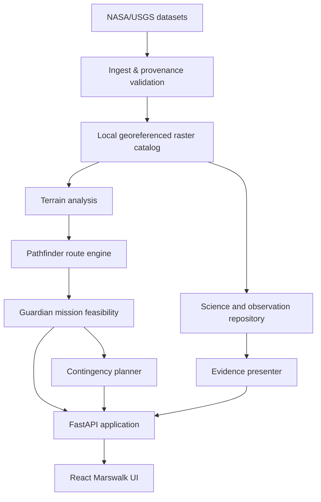

# EVA PATHFINDER — PLATFORM PRODUCT & ENGINEERING SPECIFICATION

**Version:** 1.0 — hackathon MVP architecture, 2026-11-15  
**System:** EVA Pathfinder / EVA Guardian  
**Study area:** Jezero Crater, Mars (exact region chosen after checking real shared data coverage)  
**Purpose:** Integrated, scientific, hyperlocal Marswalk map and return-aware mission decision support.

## 1. Product thesis

Orbital maps and rover records provide evidence about Mars. An astronaut needs a **localized, coherent operational view** that connects terrain, geological targets, reference images, observational history and mission constraints. EVA Pathfinder is the shared spatial/situational interface. EVA Guardian evaluates whether a planned itinerary fits modeled round-trip constraints and how a plan changes after an injected contingency.

The system is a **decision-support research demonstrator**, not a flight-certified safety device or an actual real-time Mars map. The novelty must be judged from actual implementation and comparisons, not from calling standard A*, GIS overlays, resource meters or LLM chat original in isolation.

### Mission narrative

**Operation Delta Return:** two fictional astronauts leave a hypothetical habitat, examine a documented geologically interesting area associated with the Jezero delta, and return. The habitat and science activity are hypothetical; topography and observation sources must be authentic. The route and resource estimate must be computed, not hand-drawn. A blocked-corridor event re-evaluates return feasibility from the simulated crew location.

## 2. Audience and journeys

**Primary user:** astronaut/mission planner preparing a single Marswalk.  
**Secondary:** geological scientist planning science stops; systems engineer testing contingencies; judges examining evidence.  
**Future:** rover operator/robotic autonomy stack.

### Core journey: Plan / Execute (simulated) / Respond / Explain

1. Open `Operation Delta Return` on a clipped Jezero map; recognize provenance, location, uncertainty, scale, and data time.
2. Toggle Optical, Elevation/Slope, Geological Context, Rover Images, Historic Atmosphere.
3. Place a habitat and a science waypoint using grid/map coordinates; view scientific notes.
4. Choose movement constraints (max derived slope, speed, mission time, consumable budget/reserve) with clear **illustrative scenario** label.
5. Compare two computed candidates, with actual difference where present; see reasons, source, elevation graph and route metrics.
6. Accept a plan only if outbound, activity and return meet configured hard checks; otherwise receive reason codes.
7. Scrub a simulated mission progress control to a current route cell, inject a blockage on the old return corridor, recalculate from current position/remaining budgets.
8. Inspect a before/after plan and source evidence; download or copy report JSON.

## 3. Scope discipline

| Level | Features | Conditions |
|---|---|---|
| P0 | Authentic georeferenced NASA/USGS terrain, aligned optical layer or disclosed optical limitation, geologic context, route engine, return budget, one contingency, provenance UI, automated tests | Required for a credible demonstration |
| P1 | Curated rover photos, historical MEDA time/space-labeled panel, multiple stops, shareable report, responsive tablet layout | Add when P0 verified |
| P2 | 3D digital twin, real rover integration, ROS 2, visual SLAM, LLM commands, risk-model calibration, sophisticated active perception | Not MVP; no claims of being built |

No GPU-intensive model training, complex microservices, artificial real-time Mars weather, or invented detailed astronaut physiology.

## 4. UX / information architecture

### 4.1 Navigation

- **Mission Overview:** selected study area, objective, status, assumed budgets, data integrity indicator.
- **Mars Map:** primary surface; layer switcher and legend; origin/goal/science markers; source timestamps and spatial scale.
- **Routes:** candidate comparison, distance/time, slope/altitude charts, hard constraints and risk/coverage explanation.
- **Guardian:** total trip, reserves and feasibility; color and text statuses (`FEASIBLE`, `INFEASIBLE`, `UNKNOWN`).
- **Contingency Lab:** mission-progress scrubber; inject obstacle, adjust budget; show event log and re-plan reasoning.
- **Science/Evidence:** science target cards, source images and source URLs, geology and atmospheric context, methodology.

### 4.2 Wireframe — desktop

```text
+--------------------------------------------------------------------------+
| EVA PATHFINDER / GUARDIAN | Jezero Region | DEM source | SIMULATED MISSION|
+----------------------+--------------------------------+------------------+
| LAYERS / MISSION     |    HYPERLOCAL MARS MAP         | GUARDIAN CHECKS  |
| [x] Optical          |                                | Status: ...      |
| [x] Slope/Elevation  |   H --> path --> Science site  | Time/reserve     |
| [x] Geology          |   alternative & return path    | Constraint flags |
| [ ] Rover photos     |   event barrier overlay        | Observed/derived |
| [ ] Historic weather |                                | /assumed/unknown |
| Mission inputs       +--------------------------------+------------------+
| Origin / Goal        | Route A vs Route B / elevation profile / science  |
| Mobility & budgets   | Contingency replay / source provenance / results |
+----------------------+---------------------------------------------------+
```

### 4.3 Tablet / field mode

Single full-width map with collapsible route step bar, resource status, science stop information and source label; no helmet HUD or heads-up navigation claims unless actually delivered. Maps are static historical sources; simulated avatar/position is explicitly marked.

### 4.4 Visual language

Dark, low-glare mission-control UI: charcoal and rust/orange accents; use clear accessible contrast and labels. Color is never the only indication of danger. Prefer authentic NASA/USGS source imagery with credits. Do not create or alter NASA logos/mission branding with SI. Any AI-generated visual must be visibly watermarked under the user's NASA 2026 guide. Dynamic maps use scale bar in metres, latitude/longitude with an explicit Mars convention, optional local projected grid x/y, north arrow if projection understood, and precise legend.

### 4.5 Visualizations

| Visualization | Data source / calculation | User interpretation |
|---|---|---|
| Optical map | CTX orthoimage/Mars Trek | Where the route lies relative to visible features |
| Slope heatmap | DEM gradients | Macro-terrain steepness, NOT individual rocks |
| Geology overlay / waypoint card | USGS geology + documented locations | Why a science stop is interesting |
| Route overlays | A* computed paths | Measured lengths, constraints, uncertainty difference |
| Elevation profile | DEM samples on route | Total climb/descent, grade along path |
| Resource budget bars | Explicit scenario model | Illustrative remaining time/consumable vs reserve |
| Contingency before/after | Recomputed planning result | Why plan changes and whether return is feasible |
| Evidence drawer | Dataset manifest & processing lineage | What is observed vs derived vs assumed |
| Rover photo viewer | Official image + verified metadata | Ground perspective or labeled contextual image |
| Weather history panel | MEDA selected dated record | Historical condition at rover, not live EVA forecast |

## 5. System architecture — modular monolith



**Deployment:** frontend and backend in one repository and one local deployment footprint; offline preprocessed data and HTTP API. Future adapters may expose route requests to a ROS 2 rover, but no ROS coupling in domain code.

### Context boundaries / ports

- **Cartography & Terrain Context** — ownership of map grid, DEM, gradients, exclusion masks, CRS and dataset identities.
- **Science & Observations Context** — curated geologic targets, rover images and historical atmospheric readings; factual provenance.
- **Navigation Context (Pathfinder)** — waypoint graph/grid routing, geometry, metrics and route reason codes.
- **Mission Operations Context (Guardian)** — mission, resources, activity duration, travel progression, reserves, feasibility.
- **Scenario / Contingency Context** — explicit injected events applied to a copy of terrain and current mission state.
- **Evidence Context** — fact/derivation/assumption labels, source citations, limitations, technical report.
- **Presentation Context** — API DTOs and frontend state; must never recompute contradictory mission metrics.

Cross-context data exchange through typed DTOs and identifiers; not shared mutable dictionaries. These are logical boundaries, **not network microservices**.

## 6. Domain-Driven Design (DDD)

### Ubiquitous language

- **Observation:** source recorded by a Mars mission/instrument, with metadata and provenance.
- **Derived layer:** reproducible computation from one or more observations, e.g. slope.
- **Unknown region:** terrain with missing/inadequate elevation coverage or unresolved obstacle condition.
- **Waypoint:** location in a specified Mars grid/CRS (may be hypothetical or recorded).
- **Science target:** waypoint with objective, verified context and optional work duration.
- **Route:** ordered sequence of valid cells/positions with derived metrics and constraints.
- **Traversal profile:** assumed speed and passability model for a movement mode.
- **Mission plan:** outbound route, science activities, return route, configured resources and reserves.
- **Contingency event:** explicitly simulated change to a scenario map or resource state.
- **Feasibility assessment:** `FEASIBLE`, `INFEASIBLE` or `UNKNOWN` under **stated model**.
- **Evidence record:** source identifier, derivation chain, time, resolution, type/level and caveat.

### Aggregates and invariants

1. `TerrainDataset` aggregate references immutable raw source and preprocessed layers; coordinates must carry CRS and units; NaN/nodata never silently navigable.
2. `MissionPlan` aggregate owns origin, science stops, bounds, budgets, reserve and traversal profile; no accept state without outbound **and** return checks.
3. `MissionExecution` aggregate owns simulated current position, elapsed travel/activity and remaining budget; events append to an auditable log.
4. `FeasibilityAssessment` value object includes status, metrics, reasons, assumptions, source manifest IDs.
5. `ContingencyScenario` aggregate applies changes to a versioned scenario overlay, not the immutable authoritative Mars map.

**Rules/invariants:** mission points inside valid grid; mission start and goal must be separately identified; no negative budgets, no unlabeled resource units, no route through hard-excluded terrain; accepted plan must satisfy all hard constraints; simulated events never become observed hazards; route metrics and cost computation share one physical length/units convention.

### Domain events (internal, not message broker)

`MissionConfigured`, `MapLayerLoaded`, `RouteComputed`, `FeasibilityEvaluated`, `ScienceStopReachedSimulated`, `ContingencyInjected`, `RouteReplanned`, `MissionMarkedInfeasible`, `EvidenceReportGenerated`. A simple in-process event log suffices.

### Application services

- `PrepareStudyArea` (use infrastructure repositories; no domain GIS I/O)
- `PlanCandidateRoutes`
- `EvaluateMarswalk`
- `AdvanceSimulatedMission`
- `InjectContingencyAndReplan`
- `BuildMissionEvidenceReport`

## 7. Object-Oriented Design (OOP)

Favor **composition, immutability, dependency inversion and testability** over inheritance trees. Suggested Python types:

```python
from dataclasses import dataclass
from typing import Protocol, Sequence

@dataclass(frozen=True)
class MapPoint:
    x_m: float
    y_m: float
    crs_id: str

@dataclass(frozen=True)
class RouteMetrics:
    length_m: float
    elevation_gain_m: float
    max_derived_slope_deg: float
    estimated_minutes: float

class TerrainRepository(Protocol):
    def metadata(self) -> dict: ...
    def traversal_grid(self, dataset_id: str): ...

class RoutePlanner(Protocol):
    def find_path(self, grid, start, goal, policy): ...

class ResourceEstimator(Protocol):
    def evaluate(self, route_segments, activity, profile): ...
```

Concrete infrastructure implementations: `RasterioTerrainRepository`, `AStarGridPlanner`, `IllustrativeTimeConsumableEstimator`, `JsonScienceRepository`, `InMemoryScenarioEventStore`. Use Pydantic at API boundaries; dataclasses or typed internal models in the domain. Validate and convert at the application layer. Encapsulate raster shape/transform in one `TerrainGrid` rather than passing raw arrays and coordinate transforms independently.

### SOLID guidance

- **S** single responsibility: slope analysis separate from map rendering and mission resources.
- **O** open for extensions: new route policies, science data adapters.
- **L** any planner adapter must honor route geometry/status contract.
- **I** small ports; callers only depend on required capabilities.
- **D** application services depend on protocols, not Rasterio/HTTP frameworks.

## 8. Data-Driven Architecture (DDA)

**Definition for this project:** Data sources and quality determine what the app can display, calculate, and assert. Ingest observations once; derive versioned planning products; present traceable decisions. Do not embed data into algorithms as ad-hoc constants.

### Data lifecycle

```text
RAW / BRONZE                NORMALIZED / SILVER            DERIVED / GOLD
NASA DEM, images, maps  --> Validated Mars CRS grid --> slope/exclusions/route costs
PDS MEDA records        --> dates, units, flags     --> historical context panel
Science records         --> site metadata/provenance--> science waypoint overlays
                                                     |
                                                     v
                                       mission/route result + evidence manifest
```

Each derived artifact has `artifact_id`, `source_ids`, `processing_version`, `checksum`, `created_at`, `CRS`, `resolution`, `nodata_policy`, `units`, and `limitations`. Maintain a change log of processing/algorithm parameter values. Cache derived products; re-run when source content or transformations change. Do not force SQL for small MVP; JSON + GeoTIFF + GeoJSON (only when CRS appropriate) suffice.

### Data contracts

- Mars coordinates must include target body and coordinate convention (planetocentric/planetographic, east-positive, domain and projected CRS).
- Elevation in metres; sample coordinates reference the affine transform. North-up assumption must be tested rather than assumed.
- Images with unreliable geolocation cannot be overlaid as precise coordinates; surface photos can live in contextual cards.
- MEDA historical values need sol/time, station/rover, unit, quality flags and explicit temporal/geographic scope.
- Three statuses for datasets: `AVAILABLE_VERIFIED`, `PARTIAL`, `UNAVAILABLE`; don't hide missing layers.
- Avoid large binary files in Git; document hash, source and download/reproduction command.

### Derived-vs-observed reasoning

```
Observed: DEM samples, optical pixels, rover photographs, archive measurements
Derived: slope raster, route length, elevation gain, route geometry
Assumed: astronaut speed, maximum negotiable slope, time budget, consumable rate
Simulated: habitat, EVA crew, science activity duration, blocked route, failure event
Unknown: fine-scale rocks, soil mechanical strength, unmeasured realtime atmosphere
```

## 9. Navigation and Guardian mathematics

**Slope:** for DEM `z(x,y)` in metre-based projected grid,

`gradient_norm = sqrt((dz/dx)^2 + (dz/dy)^2)`; `slope_deg = atan(gradient_norm) * 180/pi`. `dx,dy` from affine transform. Handle nodata and borders explicitly.

**A*** with 8-neighbor connectivity and no diagonal corner-cutting; hard-exclude nodata or prohibited slope; step length from spatial coordinates; `C_ij = length_ij * (1 + w_s*normalized_slope_ij + w_u*uncertainty_ij)`, all weights nonnegative. Set admissible heuristic straight-line distance when each step cost >= its horizontal distance. Distinguish local raster slope from a fully verified footpath. Provide uniform-distance feasible path as baseline.

**Return-aware evaluation:** with start H, science site S, and return H, evaluate outbound, stop and return separately. Require `T_out + T_science + T_return <= T_available - T_reserve`; similarly, illustrative consumable budgets must meet their explicit reserve. If path to H is unreachable after failure, mark infeasible. For onboard status, route replan begins at **current** simulated position, budgets reflect spent travel and science work, and obstacles affect a scenario copy of the map.

**Mission quality tradeoffs:** present route distance, ascent, unknown coverage, modeled time and reserve individually. Do NOT collapse into opaque 'astronaut safety score' or claim true probability of fatality.

**Uncertainty:** P0 treat missing elevation as exclusion; route-through-uncertain can be an opt-in scenario but is not asserted safe. Source resolution is central: a 20 m DEM cannot resolve rocks and human-scale hazards.

## 10. Interfaces and API shape

Suggested endpoints:

- `GET /health` — service/data readiness (no fake ready state).
- `GET /api/v1/datasets` — source IDs, available layers, extent/CRS, verification status.
- `GET /api/v1/study-area` — bounds and map transforms.
- `GET /api/v1/layers/{id}` — clipped overlay metadata and image/tile access.
- `GET /api/v1/science-sites` — curated science targets, source links, time scopes.
- `POST /api/v1/routes/compare` — origin/goal, policies -> 0/1/2 actual computed routes, metrics, caveats.
- `POST /api/v1/missions/evaluate` — routes, activity and budgets -> status, reasons, reserves.
- `POST /api/v1/scenarios/replan` — prior mission state + event -> updated route/feasibility, old/new metrics.
- `GET /api/v1/observations` — verified records/images if ingested.
- `POST /api/v1/reports` — structured report; include provenance and scenario vs observed.

Full request/response examples live in `08_DOMAIN_AND_API_CONTRACTS.md`. Use deterministic error codes for invalid map coordinates, data unavailable or unsupported projection.

## 11. Nonfunctional security, accessibility, deployment

- Limit server computation: max map dimension/cell count, max waypoint count, rate limiting if public, request timeouts, CORS restricted in prod.
- No remote arbitrary URL fetch from client supplied parameters (SSRF); data sources are configured and allowlisted.
- Make input explicit and bounded; reject NaN/inf, negative budget, nonmatching CRS and out-of-bounds points.
- Never expose unlicensed imagery, hidden credentials or large private assets.
- Keyboard focusable controls, explicit labels, text-based status and graph descriptions, useful loading/error feedback.
- Versioned frontend/backend API and sample request fixtures; static layers cached for performance.
- No mandatory user accounts or external telemetry needed for the hackathon.

## 12. Team evidence and success metrics

Compare minimum-distance feasible routing vs terrain-aware routing on identical terrain and constraints; report verified **length, elevation metrics, uncertain exposure, resource estimates** and same mission parameters. Verify no hard-mask violations; measure median planning runtime on a stated machine and region. Provide an ablation scenario: removing a corridor or tightening a budget changes feasibility as logically expected. Never invent a performance improvement figure. Log actual results in `docs/VERIFICATION_REPORT.md`.

## 13. Roadmap after MVP (not submission claims)

1. Improved HiRISE scale where coverage and resource budget allow.
2. Rover ground-view registration, human review of scientific waypoint context.
3. Global mission planning to rover ROS 2/Nav2 waypoints; local obstacle detection remains robot responsibility.
4. Ground robot data acquisition and active perception/scouting, separate observed vs simulated streams.
5. Historical solar/atmospheric/radiation data comparisons with verified metadata.
6. 3D terrain preview/digital twin only after correct vertical/horizontal scale calibration.

**Success definition:** A truthful, reproducible, NASA-data-based map and expedition decision tool with a functional failure-replanning demonstration and an understandable source trail.
