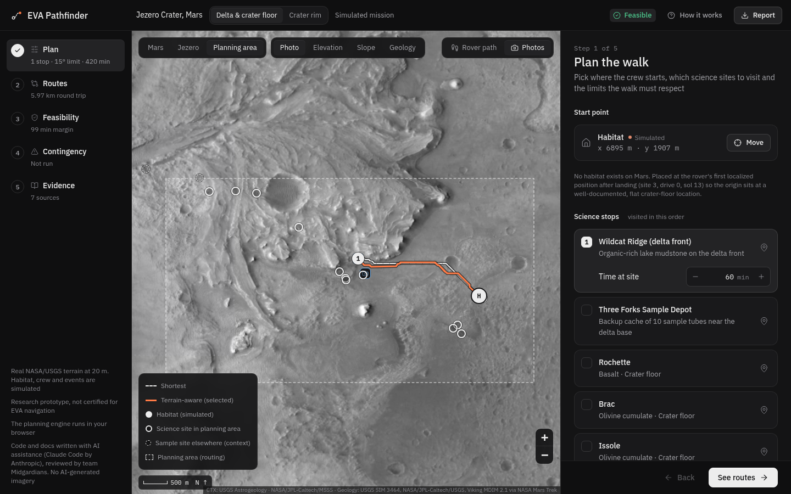

# EVA Pathfinder / EVA Guardian

Return-aware Marswalk planning on **real Jezero Crater terrain** (NASA Space Apps 2026, *Interplanetary Survival Guide: Martian Map*).

**Live app:** https://midgardians.darelladero.tech/ (GitHub Pages, HTTPS enforced, verified 2026-11-16 with a full browser smoke test; https://black-panzero.github.io/EVA-Pathfinder/ redirects there). The static build runs the same Python planning engine in your browser via Pyodide; first load takes about 15 s.

> **Research prototype. Not certified for astronaut EVA navigation or life-support decisions.** A 20 m DEM cannot show rocks or human-scale hazards. The habitat, crew and events are simulated.



## What it does

- **Map.** Zooms from the whole of Mars (NASA Mars Trek Viking colour mosaic) into the full 32 × 30 km USGS CTX mosaic of Jezero, then into an 8.1 × 4.5 km planning area where routes are computed. The planning area has detail layers (6 m orthomosaic, 20 m DTM elevation, slope, hillshade, USGS SIM 3464 geology). The map also shows Perseverance's full path (554 end-of-drive positions to sol 2022), geolocated Navcam photos, and **23 science sites**: every Perseverance rock and regolith sample site to sol 2018, placed from NASA's Mars 2020 Initial Reports. Two planning areas cover the sites. **Delta & crater floor** (8.1 × 4.5 km, 14 plannable sites) and **Crater rim** (7.9 × 5.2 km, 10 plannable sites; 830 m of relief) are switched from the top bar or by clicking an area outline on the map. Links can open a specific area with `?area=jezero-crater-rim-v1`. Routes are planned inside one area at a time.
- **Pathfinder.** 8-neighbour A* in ground metres with a hard slope limit, no-data exclusion and no corner cutting. It computes a *shortest feasible* and a *terrain-aware* route and reports length, gain and loss, maximum and mean slope, unknown fraction and an elevation profile.
- **Guardian.** Round-trip feasibility (`FEASIBLE` / `INFEASIBLE` / `UNKNOWN` with reason codes) against an illustrative time and consumable budget with a reserve.
- **Contingency Lab.** Scrub mission progress and inject a simulated blocked zone. The engine replans from the crew's current position with the resources already spent, and reports "no feasible return" when that is the truth.
- **Evidence.** Every value is labelled NASA observation / derived / illustrative model / simulated / unknown, with source links, checksums, alignment checks and a downloadable JSON report.

## Quick start

```bash
make setup   # Python 3.12 venv (uv or venv) + npm install
make data    # download allowlisted NASA/USGS sources, verify SHA-256, build data/processed/
make dev     # API http://127.0.0.1:8000  +  UI http://127.0.0.1:5173
```

Static build (GitHub Pages): `python scripts/build_static_site.py` exports the prepared data to `frontend/public/static/`, then `cd frontend && VITE_BASE=/EVA-Pathfinder/ npm run build:static`. `.github/workflows/pages.yml` runs the tests and deploys on every push to `main`. A parity test (`backend/tests/test_static_bridge.py`) checks that the in-browser engine returns exactly the same routes and totals as the API server.

Other targets: `make test` (pytest + vitest), `make lint` (ruff, mypy, tsc), `make build`, `make inspect` (writes `docs/DATA_INSPECTION.md`), `make smoke` (Playwright smoke test and screenshots; needs `make dev` running).

Requirements: Python ≥ 3.11 with GDAL wheels (installed with rasterio), Node ≥ 18, about 450 MB of disk for raw data. No credentials. Works offline after `make data`.

## Data (actually ingested)

| Category | Source | Status |
|---|---|---|
| Topography | USGS Mars 2020 TRN CTX DTM mosaic, 20 m (MRO CTX) | AVAILABLE_VERIFIED (sha256 `16a1aa66…`) |
| Optical | USGS Mars 2020 TRN CTX orthomosaic, 6 m | AVAILABLE_VERIFIED, same grid as the DTM |
| Geology | USGS SIM 3464 (Sun & Stack 2020) | PARTIAL: documented 100-200 m offsets, shown as regional context |
| Rover positions | NASA Mars 2020 waypoint service | AVAILABLE_VERIFIED; DEM matches rover elevations with a median 1.55 m absolute difference over 252 points |
| Rover photos | NASA Mars 2020 raw Navcam (sols 502, 684) | Geolocated by site/drive |
| Sample sites | NASA Mars 2020 Initial Reports (PDS sample dossier), NASA sample pages | 21 sample sites + 2 curated sites; coring sols, report coordinates |
| Global basemap | NASA Mars Trek, Viking MDIM 2.1 colour mosaic (232 m) | Context only; loaded live from trek.nasa.gov |
| Atmosphere (history) | PDS MEDA derived data, sol 684 (pressure, irradiance) | Historical only |

Details: [`docs/DATA_PROVENANCE.md`](docs/DATA_PROVENANCE.md), [`docs/DATA_INSPECTION.md`](docs/DATA_INSPECTION.md).

## Repository layout

```
backend/app/domain/          terrain (TerrainGrid, slope), navigation (A*), mission (Guardian), contingency, evidence
backend/app/application/     MissionService: compare routes, evaluate, replan, run manifest
backend/app/infrastructure/  file repositories for prepared data (no remote fetches at runtime)
backend/app/api/             FastAPI app + Pydantic v2 schemas
backend/tests/               53 tests (synthetic fixtures + real-DEM smoke tests)
frontend/src/                React + TypeScript + Leaflet CRS.Simple UI
scripts/                     prepare_data.py, inspect_data.py, browser_smoke.py
config/                      sources allowlist + checksums, study area, science sites, mission defaults
data/processed/              prepared study area (small, attributed); data/raw/ is git-ignored
docs/                        decisions, provenance, methods, limitations, verification, runbook, submission draft
```

## API (v1)

`GET /health` · `GET /api/v1/datasets` · `GET /api/v1/study-area` · `GET /api/v1/layers/{id}` (+`/image`) · `GET /api/v1/science-sites` · `GET /api/v1/observations` · `GET /api/v1/missions/default` · `POST /api/v1/routes/compare` · `POST /api/v1/missions/evaluate` · `POST /api/v1/scenarios/replan` · `POST /api/v1/reports`. Interactive docs are at http://127.0.0.1:8000/docs.

## Working / not implemented

| Feature | State |
|---|---|
| Real georeferenced DEM, ortho, geology, rover photos, MEDA history | Working |
| Two computed route policies, metrics, elevation profile | Working |
| Round-trip Guardian with reserve and reason codes, multi-stop (≤ 3) | Working |
| Contingency replan from simulated position, honest no-route | Working |
| Provenance badges, run manifest, JSON report | Working |
| Responsive / mobile layout | Working (basic) |
| HiRISE-scale terrain, 3D view, ROS 2 export, LLM commands | Not implemented (roadmap only) |
| Public deployment | Live at https://midgardians.darelladero.tech/ (GitHub Pages, Cloudflare DNS) |
| Video, slides | Not done: human action |

## Methods, caveats, verification

[`docs/ALGORITHM_METHODS.md`](docs/ALGORITHM_METHODS.md) · [`docs/ASSUMPTIONS_AND_LIMITATIONS.md`](docs/ASSUMPTIONS_AND_LIMITATIONS.md) · [`docs/VERIFICATION_REPORT.md`](docs/VERIFICATION_REPORT.md) · [`docs/DEMO_RUNBOOK.md`](docs/DEMO_RUNBOOK.md) · [`docs/DECISIONS.md`](docs/DECISIONS.md) · [`docs/NASA_SUBMISSION_DRAFT.md`](docs/NASA_SUBMISSION_DRAFT.md)

## Credits and AI disclosure

Data: USGS Astrogeology, NASA/JPL-Caltech/MSSS, USGS SIM 3464 (Sun & Stack 2020), Mars 2020 MEDA team / NASA PDS. See [`NOTICE.md`](NOTICE.md). The code and docs were written by an AI coding agent (Claude Code) from AI-assisted specification documents. No AI-generated imagery is used. The route and feasibility engine is deterministic and uses no AI at runtime. The code licence has not been chosen yet.
